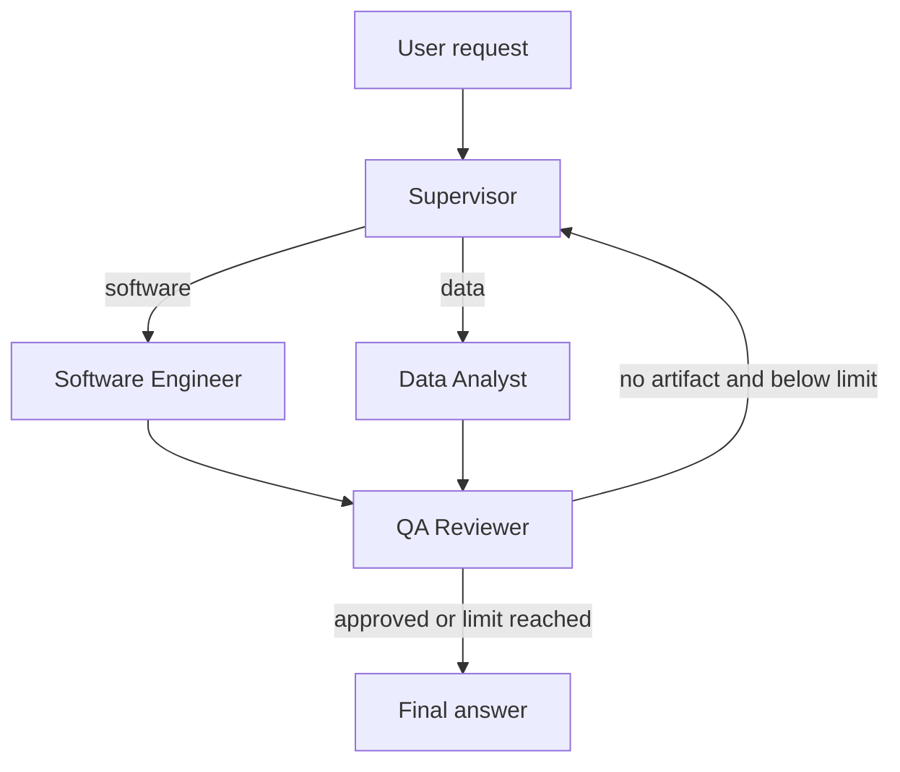
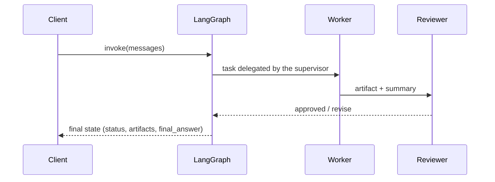

🌐 **English** | [Português (BR)](README.pt-BR.md)

# AI Multi-Agent System

[](https://github.com/PresetyX/AI-Multi-Agent-System/actions/workflows/ci.yml)


Working prototype of a multi-agent system architecture in **LangGraph**: a supervisor
classifies the request, delegates it to a specialist agent (software engineering or data
analysis), and a reviewer either approves the result or sends it back for another attempt,
with an iteration limit. It includes tools with security restrictions (code execution, files
and document search) and end-to-end tests of the graph.

> **Current status: prototype.** The focus here is orchestration (typed state, conditional
> routing, a bounded review loop) and the tools. The agent nodes are still
> **deterministic**: the supervisor routes by keywords and the workers generate plan
> artifacts, without calling an LLM. Plugging an LLM into each node is the next step (see the roadmap).

## Architecture





| Component | What it does today |
|---|---|
| `GraphState` | Typed, serializable state shared between the nodes (messages, active worker, artifacts, status, revision count). |
| Supervisor | Extracts the latest user message and routes by keywords (`csv`, `dataset`, `data`, `statistics`...). |
| Workers | Produce a structured artifact (`engineering` or `data_analysis`) with the plan for the task. |
| Reviewer | Approves when there is an artifact; otherwise sends it back to the supervisor up to `MAX_REVIEW_LOOPS`. |
| `execute_python` | Runs code in a subprocess, in a temporary directory, with a timeout and a minimal environment (it does not inherit variables such as API keys). |
| `file_ops` | Reads and writes restricted to `WORKSPACE_ROOT`, blocking path traversal (`../`, absolute paths). |
| `VectorStore` | In-memory index with term-overlap search; the interface is ready to be swapped for Chroma. |

## Quick start

```bash
git clone https://github.com/PresetyX/AI-Multi-Agent-System.git
cd AI-Multi-Agent-System
python -m venv .venv && source .venv/bin/activate   # Windows: .venv\Scripts\activate
pip install -e ".[dev]"
cp .env.example .env
pytest
```

```python
from src.graph import build_graph

app = build_graph()
result = app.invoke({"messages": [{"role": "user", "content": "Analyze this CSV dataset"}]})
print(result["active_worker"])  # data_analyst
print(result["final_answer"])   # Prepared an analysis plan for: Analyze this CSV dataset
```

## Tests

17 tests, about 96% coverage, running without network access or API keys:

- full graph flow for both workers and routing by the most recent message;
- review loop: retry when there is no artifact, and stop when `MAX_REVIEW_LOOPS` is reached;
- code executor: success, error, timeout, empty code, temporary directory and
  environment-variable isolation (a key set in the parent process does not reach the executed code);
- files: round trip inside the workspace and blocking of `../`, `notes/../../` and absolute paths;
- search: ranking by overlap and indexing of `.py`, `.md`, `.txt` and `.toml` only.

CI (GitHub Actions) runs `ruff` lint and the tests on Python 3.11 and 3.12.

## Design decisions

- **Keyword-based supervisor today, LLM on the roadmap.** Routing is deterministic and
  testable without an API key. The limitation is that it can only tell apart what the keywords cover.
- **Review with a cap on attempts.** The reviewer sends the request back to the supervisor, but
  `route_review` always ends when `MAX_REVIEW_LOOPS` is reached, so the graph can't loop forever.
- **Typed, serializable shared state** (`GraphState`): messages, active worker,
  artifacts, status and revision count live in a single place.
- **Workers return structured artifacts** (`engineering` or `data_analysis`), and the reviewer
  approves based on the existence of the artifact, not on free text.
- **Generated code runs in a subprocess, in a temporary directory, with a timeout and a minimal environment.**
  Only `PATH` and `PYTHONNOUSERSITE` are passed through, so that API keys don't leak into the
  executed code. This reduces risk, but it is not a sandbox, and this README says so explicitly.
- **`file_ops` restricted to `WORKSPACE_ROOT`,** blocking `../` and absolute paths.
- **In-memory `VectorStore`, accessed only through the retriever** (`src/tools/retriever.py`), with
  the swap to a persistent Chroma planned on the roadmap.

## Security limitations

The code executor **is not an isolated sandbox**. It reduces risk (timeout, temporary
directory, an environment without secrets), but the process can still access the network and read files that
the operating system user can read. For untrusted code, run it inside a
container with no network (`docker run --network none --read-only ...`), gVisor or Firecracker.

## Configuration

| Variable | Default | Use |
|---|---|---|
| `WORKSPACE_ROOT` | `./workspace` | The single folder where the file tools may read and write. |
| `MAX_CODE_SECONDS` | `10` | Code executor timeout. |
| `MAX_REVIEW_LOOPS` | `2` | Maximum number of reviewer → supervisor round trips. |
| `OPENAI_API_KEY` / `ANTHROPIC_API_KEY`, `AI_MODEL` | empty / `gpt-4o-mini` | Reserved for the LLM integration on the roadmap; not read by the nodes yet. |
| `RAG_PERSIST_DIRECTORY` | `./.chroma` | Reserved for replacing the in-memory index with Chroma. |

## Structure

```
src/
  agents/   # supervisor, software_engineer, data_analyst, reviewer
  tools/    # execute_python, file_ops, retriever
  rag/      # in-memory VectorStore and directory indexer
  graph.py  # StateGraph assembly and conditional routing
  state.py  # typed GraphState
tests/      # pytest (graph, tools, search)
```

## Roadmap

- [ ] LLM-based supervisor with structured output (Pydantic) in place of keywords.
- [ ] Workers with tool calling using `execute_python`, `file_ops` and `retrieve_documents`.
- [ ] Reviewer with acceptance criteria evaluated by an LLM and feedback that goes back to the worker.
- [ ] Replace the in-memory `VectorStore` with a persistent Chroma using embeddings.
- [ ] Code executor inside a container with no network.

## Development history

Developed locally between August 25 and November 17, 2026. The commit history was created afterwards, and the commit dates were adjusted to match the period in which the work was actually done.

## License

MIT. See [LICENSE](LICENSE).
