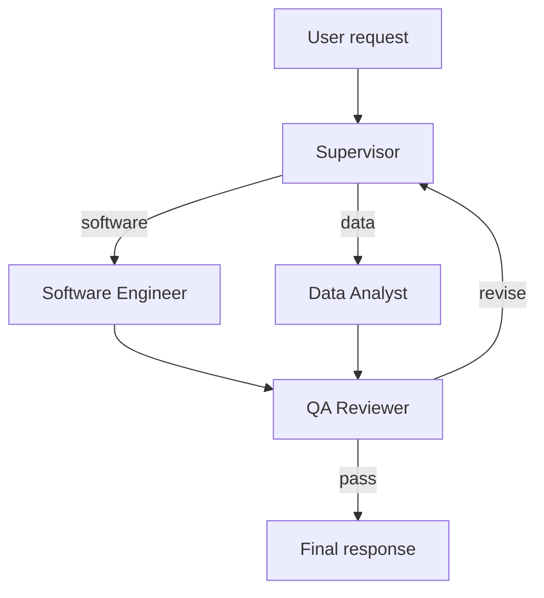
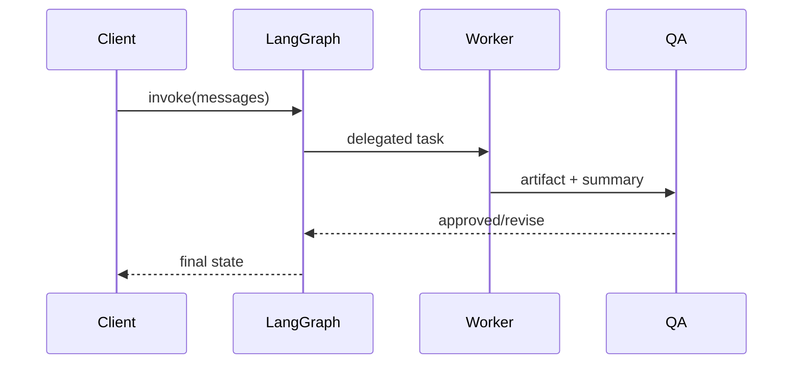

# AI Multi-Agent System

A production-oriented Python 3.11+ multi-agent runtime using LangGraph, LangChain, Pydantic v2, safe local tools, and optional Chroma RAG.

## Architecture





## Setup

```bash
uv venv --python 3.11
source .venv/bin/activate
uv pip install -e .
cp .env.example .env
pytest -q
```

Set `OPENAI_API_KEY` or `ANTHROPIC_API_KEY` for live LLM execution. Tests use deterministic fallback behavior when no provider key is configured.

## Usage

```python
from src.graph import build_graph

app = build_graph()
result = app.invoke({"messages": [{"role": "user", "content": "Analyze this CSV"}]})
print(result["final_answer"])
```

## Safety

The sandbox runs subprocesses in a temporary directory, applies a timeout, disables network access where supported, and limits environment inheritance. File operations are restricted to the configured workspace. Do not treat this as a hardened container: use Docker or a dedicated sandbox for hostile multi-tenant workloads.

## Layout

- `src/agents`: supervisor, engineering, analyst, and QA nodes.
- `src/tools`: subprocess execution, workspace file operations, and retrieval.
- `src/rag`: Chroma-backed indexing with graceful dependency/key fallbacks.
- `tests`: tool and end-to-end graph coverage.
