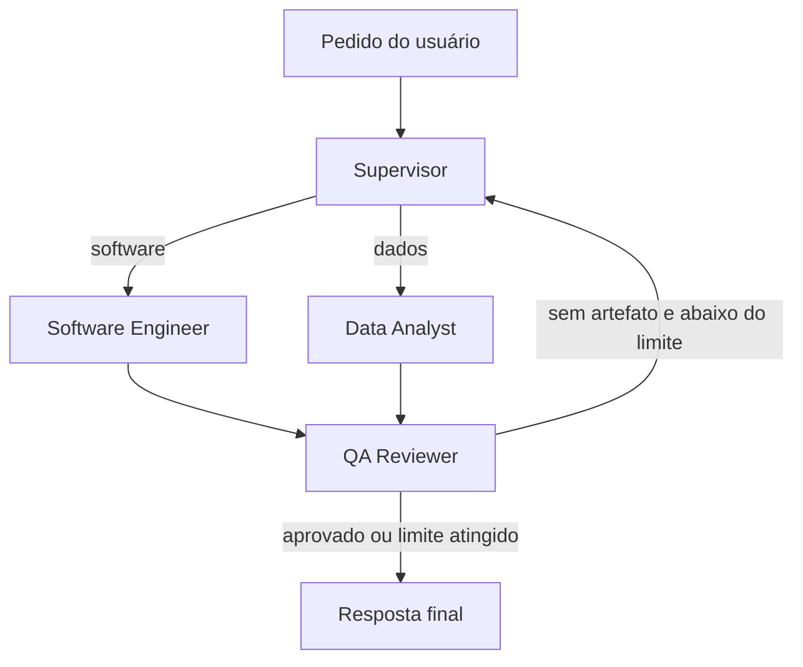
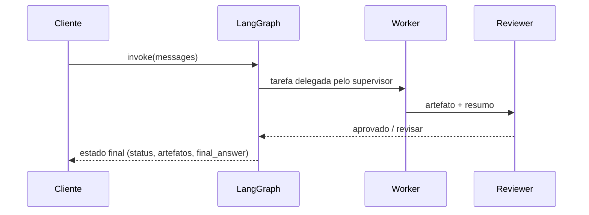

# AI Multi-Agent System

[](https://github.com/PresetyX/AI-Multi-Agent-System/actions/workflows/ci.yml)


Protótipo funcional da arquitetura de um sistema multi-agente em **LangGraph**: um
supervisor classifica o pedido, delega para um agente especialista (engenharia de software ou
análise de dados) e um revisor aprova o resultado ou devolve para nova tentativa, com limite
de iterações. Inclui ferramentas com restrições de segurança (execução de código, arquivos e
busca em documentos) e testes de ponta a ponta do grafo.

> **Estado atual: protótipo.** O foco aqui é a orquestração (estado tipado, roteamento
> condicional, loop de revisão limitado) e as ferramentas. Os nós dos agentes ainda são
> **determinísticos**: o supervisor roteia por palavras-chave e os workers geram artefatos de
> plano, sem chamar um LLM. Plugar o LLM em cada nó é o próximo passo (veja o roadmap).

## Arquitetura





| Componente | O que faz hoje |
|---|---|
| `GraphState` | Estado tipado e serializável compartilhado entre os nós (mensagens, worker ativo, artefatos, status, contagem de revisões). |
| Supervisor | Extrai a última mensagem do usuário e roteia por palavras-chave (`csv`, `dataset`, `data`, `statistics`...). |
| Workers | Produzem um artefato estruturado (`engineering` ou `data_analysis`) com o plano para a tarefa. |
| Reviewer | Aprova quando há artefato; senão devolve ao supervisor até `MAX_REVIEW_LOOPS`. |
| `execute_python` | Executa código em subprocesso, em diretório temporário, com timeout e ambiente mínimo (sem herdar variáveis como chaves de API). |
| `file_ops` | Leitura e escrita restritas ao `WORKSPACE_ROOT`, bloqueando path traversal (`../`, caminhos absolutos). |
| `VectorStore` | Índice em memória com busca por sobreposição de termos; interface pronta para trocar por Chroma. |

## Execução rápida

```bash
git clone https://github.com/PresetyX/AI-Multi-Agent-System.git
cd AI-Multi-Agent-System
python -m venv .venv && source .venv/bin/activate   # Windows: .venv\Scripts\activate
pip install -e ".[dev]"
cp .env.example .env
pytest
```

```python
from src.graph import build_graph

app = build_graph()
result = app.invoke({"messages": [{"role": "user", "content": "Analyze this CSV dataset"}]})
print(result["active_worker"])  # data_analyst
print(result["final_answer"])   # Prepared an analysis plan for: Analyze this CSV dataset
```

## Testes

17 testes, cerca de 96% de cobertura, rodando sem rede e sem chaves de API:

- fluxo completo do grafo para os dois workers e roteamento pela mensagem mais recente;
- loop de revisão: nova tentativa sem artefato e parada ao atingir `MAX_REVIEW_LOOPS`;
- executor de código: sucesso, erro, timeout, código vazio, diretório temporário e
  isolamento de variáveis de ambiente (uma chave definida no processo pai não chega ao código executado);
- arquivos: ida e volta dentro do workspace e bloqueio de `../`, `notes/../../` e caminhos absolutos;
- busca: ranqueamento por sobreposição e indexação apenas de `.py`, `.md`, `.txt` e `.toml`.

O CI (GitHub Actions) roda lint com `ruff` e os testes em Python 3.11 e 3.12.

## Limitações de segurança

O executor de código **não é um sandbox isolado**. Ele reduz riscos (timeout, diretório
temporário, ambiente sem segredos), mas o processo ainda pode acessar a rede e ler arquivos que
o usuário do sistema operacional consegue ler. Para código não confiável, rode dentro de um
container sem rede (`docker run --network none --read-only ...`), gVisor ou Firecracker.

## Configuração

| Variável | Padrão | Uso |
|---|---|---|
| `WORKSPACE_ROOT` | `./workspace` | Pasta única onde as ferramentas de arquivo podem ler e escrever. |
| `MAX_CODE_SECONDS` | `10` | Timeout do executor de código. |
| `MAX_REVIEW_LOOPS` | `2` | Máximo de voltas revisor → supervisor. |
| `OPENAI_API_KEY` / `ANTHROPIC_API_KEY`, `AI_MODEL` | vazio / `gpt-4o-mini` | Reservadas para a integração com LLM do roadmap; ainda não são lidas pelos nós. |
| `RAG_PERSIST_DIRECTORY` | `./.chroma` | Reservada para a troca do índice em memória pelo Chroma. |

## Estrutura

```
src/
  agents/   # supervisor, software_engineer, data_analyst, reviewer
  tools/    # execute_python, file_ops, retriever
  rag/      # VectorStore em memória e indexador de diretórios
  graph.py  # montagem do StateGraph e roteamento condicional
  state.py  # GraphState tipado
tests/      # pytest (grafo, ferramentas, busca)
```

## Roadmap

- [ ] Supervisor com LLM e saída estruturada (Pydantic) no lugar das palavras-chave.
- [ ] Workers com tool calling usando `execute_python`, `file_ops` e `retrieve_documents`.
- [ ] Revisor com critérios de aceitação avaliados por LLM e feedback que volta para o worker.
- [ ] Trocar o `VectorStore` em memória por Chroma persistente com embeddings.
- [ ] Executor de código dentro de container sem rede.

## Licença

MIT. Veja [LICENSE](LICENSE).
